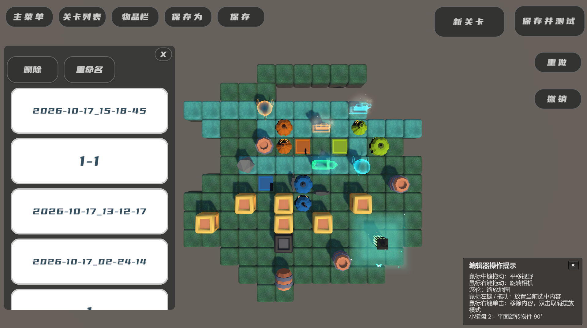
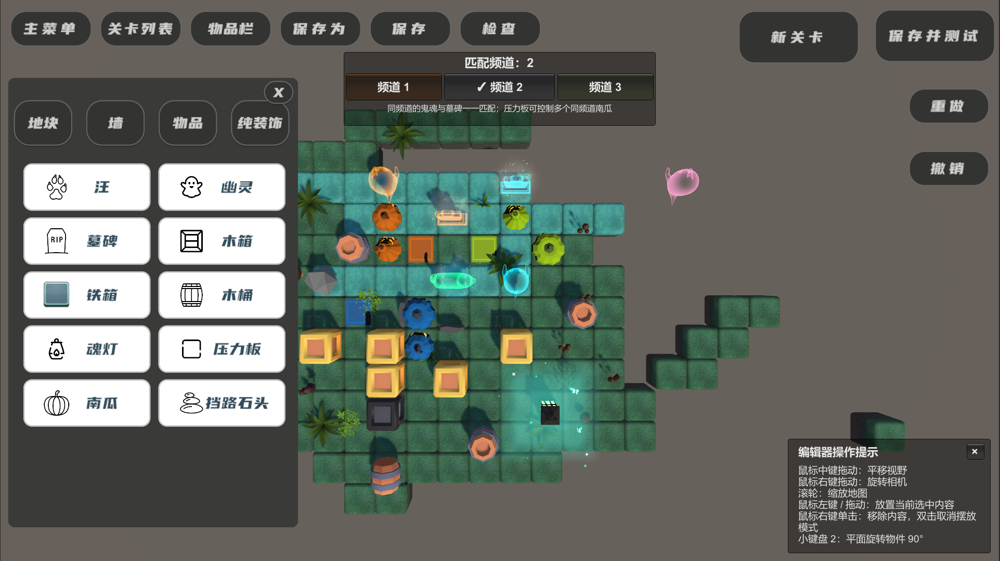
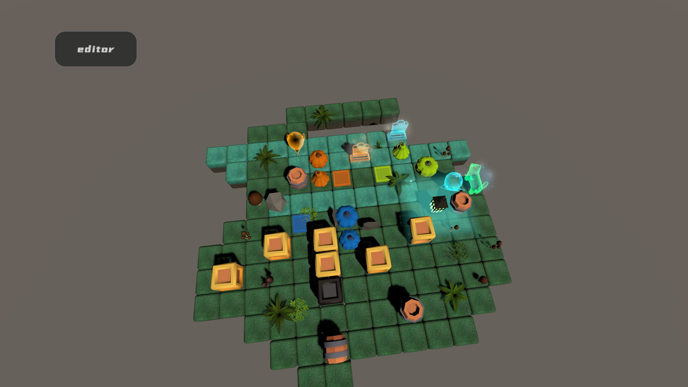
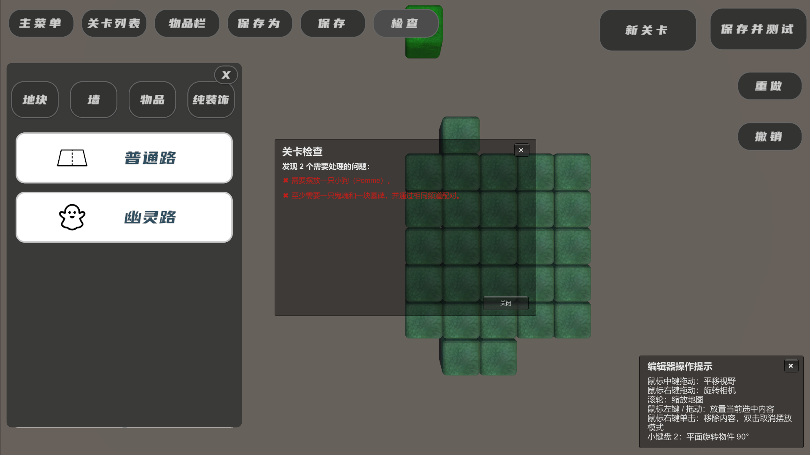
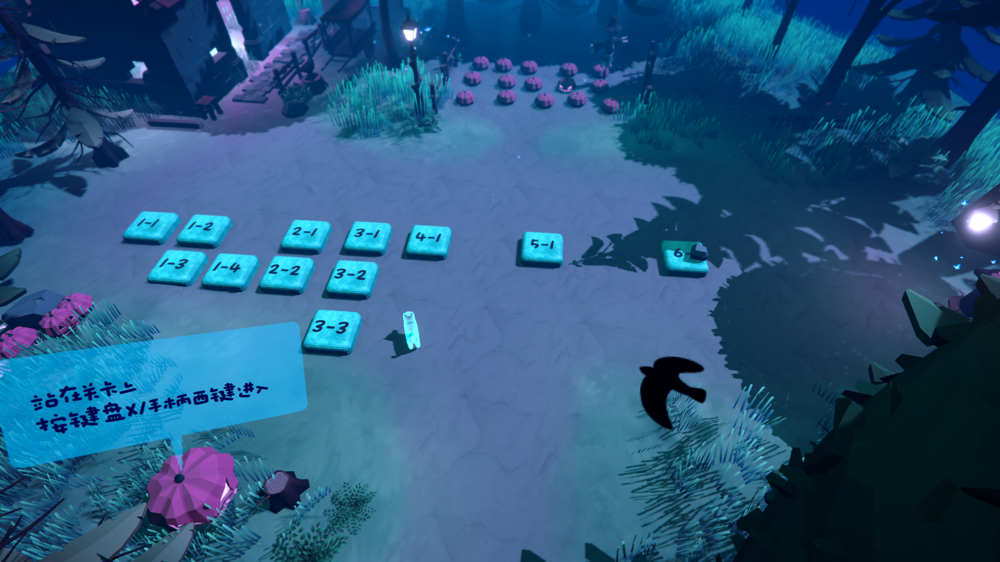
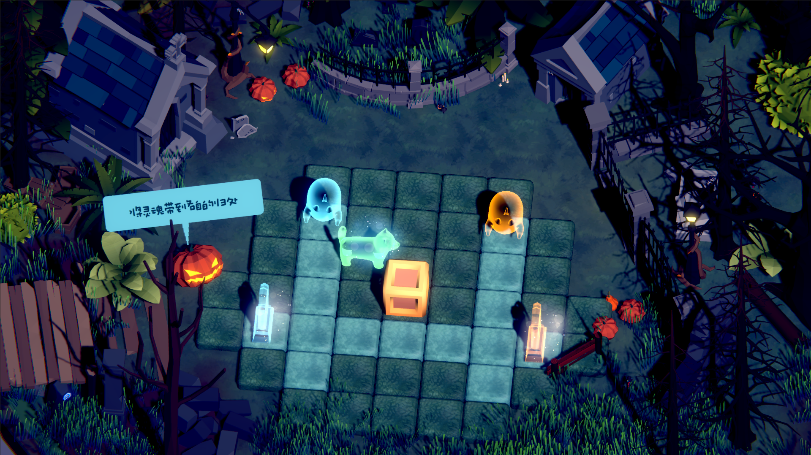
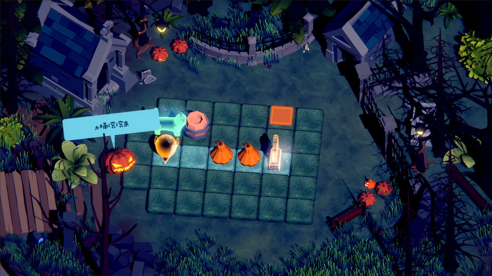

# 《汪归》

单人网格推箱子like解谜游戏。玩家控制小狗 Pomme 推动物品、改变通路，并通过 Bark 引导灵魂到达对应频道的墓碑。

Unity 版本：`2022.3.47f1c1`。主要编辑场景：`Assets/Scenes/Re/LevelEditorTest.unity`；Gameplay 场景：`Assets/Scenes/Re/Gameplay.unity`。

## 游戏展示

  
  

主菜单 · 关卡编辑器

  
  

物品摆放 · 单关卡测试

  
  

关卡检查 · 关卡表

  
  

 关卡场景

## 游戏规则

- 每关只有一张地图；小狗逐格移动，不能穿墙或穿过阻挡物。
- 灵魂不会自主移动。Bark 会吸引同一行/列、路径有效的灵魂朝小狗滑行，直到受阻。
- 灵魂停在同频道墓碑上即归位；所有灵魂归位后完成关卡。
- 墙位于相邻地块的共享边，阻挡角色和物品。墙只能放在已有地块边上。
- 地块有属性，灵魂可通行/不可通行。有机关可临时改变灵魂可通行状态。
- 阻挡物不能共占格。纯装饰可叠加，不参与移动和机关判定。

## 交互物

| 物品 | 规则 |
| --- | --- |
| 小狗 | 玩家控制，每关一个，可推动物品。 |
| 灵魂 / 墓碑 | 按频道配对；灵魂由 Bark 滑行，墓碑是目标。 |
| 木箱 | 可推动、可连锁推动。 |
| 铁箱 | 可推动，但不能作为链推中的后续物品。 |
| 木桶 | 竖立时受推会横躺；横躺时端部推动可立起，侧面推动会滚到受阻处。 |
| 魂灯 | 可推动、可连推；使周围 `3×3` 地块允许灵魂通行。 |
| 挡路石 | 不可推动的阻挡物，有多个外观。 |
| 压力板 / 南瓜 | 可触发物停在板上时，同频道南瓜消失；板上无物时南瓜恢复。 |
| 纯装饰 | 可贴地、自由叠加，不影响玩法。 |

## 操作

- **进入关卡：** 主界面选择“开始”进入关卡选择。使用 `WASD` / 方向键或左摇杆控制小狗移动到关卡按钮上，按键盘 `X` 或手柄 `West` 键进入该关卡。
- **Gameplay：** `WASD` / 方向键 / 手柄左摇杆移动；`C` / 手柄 `South` Bark；`Z` / 手柄 `North` 撤销；`R` / 手柄 `East` 重置。

**编辑器：** ui相关暂未做手柄适配，鼠标中键拖动平移相机，右键拖动旋转，滚轮缩放；左键放置，右键单击移除，右键双击退出摆放；小键盘 `2` 旋转物品。右下角可关闭/重新打开操作提示。

## 编辑器使用

1. 打开 `Assets/Scenes/Re/LevelEditorTest.unity`，在关卡列表加载关卡或新建。
2. 打开物品栏，通过界面按钮选择地块、墙、物品或纯装饰，再在地图上摆放。
3. 灵魂、墓碑、压力板和南瓜摆放时选择频道。灵魂/墓碑一对一，压力板可控制多个同频道南瓜。
4. 点击“保存”或“保存为”才写入关卡。新建不会自动保存；“测试关卡”会先保存再进入 Gameplay。

地图初始范围较小，摆放时会自动扩展。物品数量由 `maxCount` 控制，`-1` 表示不限量。纯装饰可自由叠放。关卡 JSON 默认位于 `Application.streamingAssetsPath`，文件名为 `mLD_<关卡名>.json`。

### 添加新的可摆放内容

1. 先制作好 prefab 和列表图标 Sprite，再打开 `Assets/Data/` 下对应的数据资源。
2. **地块：** 在 `TileDataList_SO.asset` 的 `tileDataList` 添加条目，设置唯一 `tileID`、名称、`TileType`、图标、prefab 和摆放偏移。
3. **墙：** 在 `WallDataList_SO.asset` 的 `wallDataList` 添加条目，设置唯一 `wallID`、名称、图标和 prefab。多种外观填入 `prefabVariants`，单一外观可填 `prefab`。
4. **物品：** 在 `ObjDataList_SO.asset` 的 `objDataList` 添加 `ObjData`，设置唯一 `objID`、名称、图标、prefab、占格 `occupiedGrids`、`maxCount` 和所需 `ObjectType` 标记。多款随机外观使用 `RandomObjData.prefabVariants`。
5. **装饰物：** 同样添加到 `ObjDataList_SO.asset`，并给 `objType` 勾选 `PureDecoration`。编辑器会将它自动显示在纯装饰列表中；它不参与碰撞和机关判定。
6. 保存数据资源后回到编辑器检查列表图标、预览、落点校验和实际摆放。ID 不要与已有条目重复；推挤、阻挡或机关行为还要与 prefab 组件及数据标记匹配。

## 开发结构

- `Assets/_Scripts/Map/`：关卡、地图、地块、墙和 JSON 读写。
- `Assets/_Scripts/Movement/`：移动、推箱、连推、木桶和灵魂移动规则。
- `Assets/_Scripts/Commands/`：摆放、移动与撤销命令。
- `Assets/_Scripts/Obj/`：角色、物品与频道表现。
- `Assets/_Scripts/Mgr/`：Gameplay、场景、进度和编辑器管理。
- `Assets/Data/`：关卡与物品配置；`Assets/Resources/ChannelPalette.asset` 保存共享频道配色。

开发流程：先统一关卡数据和编辑器，再实现移动与连推，随后加入灵魂、墓碑、魂灯、木桶和压力机关，测试单个关卡，制作更多关卡。

